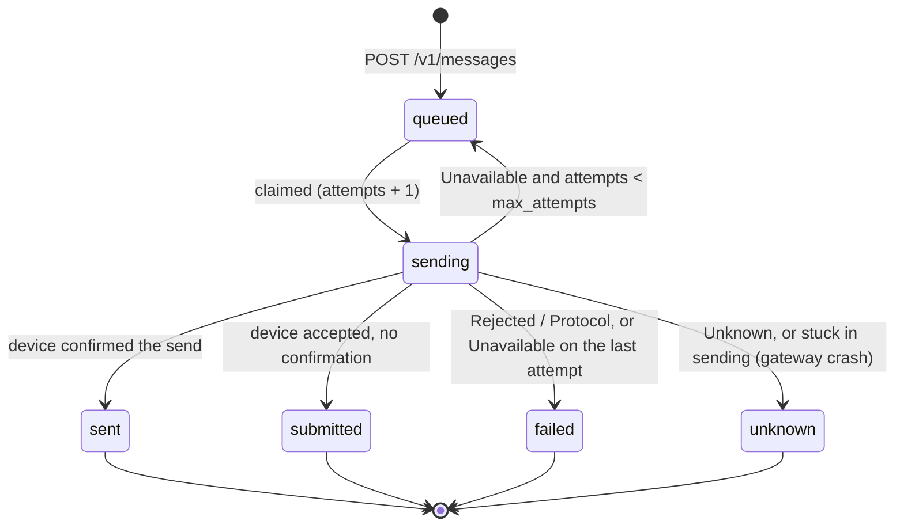

# Architecture

This document describes how `sms-gateway` is built and why. It covers the
components, the life of outbound and inbound messages, the constraints
imposed by the device, and the database schema.

- [Context](#context)
- [Components](#components)
- [Device access](#device-access)
- [Outbound messages](#outbound-messages)
- [Inbound messages](#inbound-messages)
- [Webhooks](#webhooks)
- [Pause](#pause)
- [Retention](#retention)
- [Data model](#data-model)
- [Limitations and possible extensions](#limitations-and-possible-extensions)

## Context

The TP-Link NE200-Outdoor is an outdoor 5G CPE with a SIM slot. It has no
official API, no SSH or telnet access and no AT command port: its only
management interface is the web UI. That UI talks to the device through a
single encrypted endpoint, `/cgi_gdpr`, shared by the TP-Link "EX" and "MR"
firmware families. The gateway speaks that protocol the way the browser
does. [ne200-protocol.md](ne200-protocol.md) documents it.

Four properties of the device shape the whole design:

- **One administrator session at a time.** The gateway must own a single
  session, serialize every call on it, and log in again when it is lost.
  Using the web UI while the gateway runs makes the two fight over the
  session, hence the [pause](#pause).
- **No push for inbound SMS.** The inbox has to be polled.
- **A small inbox.** Once the device inbox is full, new SMS are lost, so
  messages are deleted from the device once they are safely stored.
- **No idempotency on sends.** If a send request times out after it
  reached the device, nobody can tell whether the SMS left. Sending it
  again could deliver it twice, so such a message is never re-sent
  automatically.

## Components

```text
            HTTP + API key                      signed webhooks
  apps ──────────────────────┐            ┌──────────────────────▶ apps
                             ▼            │
 ┌─────────────────────── sms-gateway ────┼─────────────────────────────┐
 │                                        │                             │
 │  axum API ─────────▶ PostgreSQL ◀──── webhook dispatcher             │
 │  (/v1, /healthz,      ▲        ▲                                     │
 │   /metrics, /docs)    │        │                                     │
 │                 outbound    inbound      status      retention       │
 │                  worker     poller      refresher       job          │
 │                       │        │           │                         │
 │                       ▼        ▼           ▼                         │
 │             ModemHandle: one device call at a time, pause,           │
 │                          safety timeout, session health              │
 │                                  │                                   │
 │             SmsModem trait ── TplinkModem (tplink-ex) | mock         │
 └──────────────────────────────────┼───────────────────────────────────┘
                                    │ HTTP, /cgi_gdpr (AES + RSA)
                                    ▼
                       NE200-Outdoor ── SIM ── mobile network
```

The Cargo workspace has three crates:

| Crate | Role |
|---|---|
| [`tplink-ex`](../crates/tplink-ex) | Device driver: session crypto (AES-CBC/GCM, raw/OAEP RSA), login and variant detection, transparent re-login, generic acts, typed SMS and status operations. Errors say whether a request may have been executed. Independent of the gateway. |
| [`modem`](../crates/modem) | The `SmsModem` trait, its error model, the `TplinkModem` backend built on `tplink-ex`, and an in-memory `MockModem`. |
| [`gateway`](../crates/gateway) | The `sms-gateway` binary: configuration, HTTP API, PostgreSQL storage, background workers, webhooks, metrics and the CLI. |

Inside the gateway, `serve` starts these tasks:

| Task | Module | Job |
|---|---|---|
| HTTP API | `api` | Authenticates apps, validates and queues outbound SMS, lists messages, reports and controls the modem. |
| Outbound worker | `workers::outbound` | Claims queued messages one at a time, sends them, records the outcome, queues webhooks. |
| Inbound poller | `workers::inbound` | Polls the device inbox, stores and routes new messages, deletes them from the device. |
| Webhook dispatcher | `webhooks` | Delivers queued events, signs them, retries failures. |
| Status refresher | `workers` | Reads radio status (signal, operator) every `modem.status_interval_secs`. |
| Stats | `workers` | Publishes queue depth gauges every 15 s. |
| Retention job | `workers` | Purges old texts, messages and webhook deliveries. |

Every piece of state lives in PostgreSQL, apart from the in-memory session
health and the cached radio status. The gateway can be restarted at any
time; see below for what happens to a send interrupted by a crash.

Run a **single gateway instance** per device. The queue claims use
`FOR UPDATE SKIP LOCKED`, but two instances would each open their own
device session and keep logging each other out.

## Device access

`ModemHandle` (`modem_ctl.rs`) is the only path to the device:

- **Serialization.** A device call requires a `ModemSession`, which holds an
  async mutex for its lifetime. The outbound worker holds it for one send,
  the inbound poller for one whole poll cycle (unread count, inbox listing,
  deletions), the status refresher for one status read. A send can thus wait
  behind a poll, and the other way round.
- **Pause.** A session cannot be obtained while the modem is paused.
- **Safety timeout.** Every call is wrapped in `modem.op_timeout_secs`. A
  send that exceeds it ends as `unknown`; a read that exceeds it is a plain
  `Unavailable` error.
- **Health.** The result of each call updates the session state reported by
  `GET /v1/modem` and `/readyz` (`idle`, `ok`, `error`, `paused`) and the
  `sms_modem_errors_total` metric.

Below it, `TplinkModem` keeps one `tplink_ex::Client` behind its own mutex.
The client logs in lazily on the first call, detects the cipher variant,
and logs in again once, transparently, when the device rejects the session
*before* executing a request (HTTP 401/403, a redirect, or a reply not
encrypted with the session key). It never re-sends a non-idempotent act (SMS
submission, delete) whose outcome is unknown.

### Error model

`SmsModem` methods return a `ModemError` with four kinds. The kind, not
the message, drives every retry decision:

| Kind | Meaning | Examples with the TP-Link backend |
|---|---|---|
| `Unavailable` | Nothing was executed; retrying is safe. | Device unreachable, login failed (including a wrong password), session rejected twice, pre-send session check failed, device modem busy (`sendResult` 2). |
| `Unknown` | The request may have been executed. | Transport error or timeout after the send request left, HTTP 5xx or an unreadable reply to the send act, gateway safety timeout during a send. |
| `Rejected` | The device refused the request; retrying will not help. | `errorcode` on the send act, `sendResult` 0 (failed). |
| `Protocol` | The device answered something the driver does not understand. | Unexpected HTTP status, malformed JSON. |

Read-only operations (unread count, inbox listing, status) map an unknown
outcome to `Unavailable`: repeating a read is always safe.

## Outbound messages

`POST /v1/messages` validates the request (E.164 normalization, prefix
policy, text length in SMS segments, idempotency key), stores the message
as `queued` and wakes the outbound worker. It returns `202 Accepted`
immediately; the send itself is asynchronous.

### State machine



| Status | Meaning | Webhook |
|---|---|---|
| `queued` | Waiting for its first attempt or for a scheduled retry (`next_attempt_at`). | none |
| `sending` | Claimed by the worker; the device call is in progress. | none |
| `sent` | The device reported the message as sent (`sendResult` 1). | `message.sent` |
| `submitted` | The device accepted the message but gave no usable result within the polling window (about 20 s). | `message.sent` |
| `failed` | The device refused it, or every attempt found the device unavailable. | `message.failed` |
| `unknown` | The outcome cannot be known. Never re-sent automatically. | `message.unknown` |

Neither `sent` nor `submitted` is a delivery report: they only describe what
the device said about the message leaving it. Delivery reports are not
implemented.

### Claiming and pacing

The worker claims the oldest due message (`status = 'queued' AND
next_attempt_at <= now()`, ordered by `next_attempt_at, created_at`) and
moves it to `sending` with `attempts + 1` in a single statement. It waits at
least `outbound.min_interval_ms` between two attempts, because operators
dislike bursts. When idle it sleeps until woken by a new message or for
`outbound.idle_poll_ms`. While the modem is paused it claims nothing.

### Retries

Retries happen in exactly one case: the send failed with `Unavailable`
(nothing reached the device) and the message has made fewer than
`outbound.max_attempts` attempts. The message goes back to `queued` with
`next_attempt_at = now + min(retry_base_secs * 2^(attempts - 1),
retry_max_secs)`. With the defaults (10 s base, 600 s cap, 5 attempts) the
delays are 10, 20, 40 and 80 s, and the fifth failure ends in `failed`.

On top of the per-message backoff, consecutive `Unavailable` errors slow
the worker itself down with the same formula, so that a device outage does
not burn the attempts of every queued message in a few seconds.

`Rejected` and `Protocol` end in `failed` at once. `Unknown` ends in
`unknown` at once.

### Why `unknown` is never re-sent

An `Unknown` error means the send request may have been executed: for
example the HTTP request reached the device, then the connection broke or
timed out before the answer. The device offers no way to ask "did message X
leave?" (the outbox has no correlation id), and SMS has no idempotency key.
Re-sending could deliver the SMS twice, which for a one-time code, an alert
or a payment notification is worse than not sending it. The gateway records
the message as `unknown`, fires `message.unknown`, and leaves the decision
to the application, which can send a new message (with a new
`Idempotency-Key`) if a duplicate is acceptable.

The same reasoning applies to a crash. A message found in `sending` for
longer than `outbound.sending_stale_secs` (checked every minute) belongs to
a gateway that died during the device call. It is moved to `unknown` with
the error `gateway interrupted during the send`. The configuration requires
`sending_stale_secs` to exceed `modem.op_timeout_secs`, so a send still in
progress is never reaped.

### Send confirmation

After the `so DEV2_LTE_SMS_SENDNEWMSG` act, the driver polls
`DEV2_LTE_SMS_SENDNEWMSG.sendResult` every 500 ms for up to 20 s, as the web
UI does: `3` means sending, `1` sent, `2` modem busy (the message was not
sent, which maps to `Unavailable` and is retried), `0` failed. If the
attribute is missing, the value does not settle in time, or polling fails,
the message is `submitted`. See
[ne200-protocol.md](ne200-protocol.md#sending-an-sms).

## Inbound messages

The inbound poller runs every `inbound.poll_interval_secs`:

1. **Check.** Read `smsUnreadCount`, the cheapest call. Scan the inbox if
   there are unread messages, or if `inbound.full_scan_interval_secs` has
   elapsed since the last scan (a safety net for messages already marked as
   read on the device, for instance through the web UI). The first poll
   after start-up always scans. With `delete_after_ingest = false`, an
   unchanged unread count does not trigger a new scan.
2. **List.** Read every inbox page. The NE200 reassembles long
   (concatenated) SMS itself, so each entry is a whole message.
3. **Dedup and store.** In one transaction, insert each message with
   `ON CONFLICT DO NOTHING` on the dedup key `(peer, device_received_at,
   body_sha256)`: the sender as normalized by the gateway, the reception
   time reported by the device, and the SHA-256 of the text. Device inbox
   indexes are reused after deletion, so they cannot serve as a key. The
   `message.received` webhook deliveries are inserted in the same
   transaction.
4. **Delete from the device** (when `inbound.delete_after_ingest` is true,
   the default), highest index first. Each deletion re-reads the inbox and
   only deletes an entry with the same sender, text and reception time, so
   a reused index never causes the wrong message to be deleted. A deletion
   that fails because the device is unreachable stops the loop until the
   next scan.
5. **Wake** the webhook dispatcher.

A crash between two steps loses nothing: a message still on the device is
read again at the next scan and dropped by the dedup key.

The device reports a naive local time (`YYYY-MM-DD HH:MM:SS`). The gateway
keeps it as `device_received_at` (part of the dedup key) and converts it to
UTC with `modem.timezone` for `received_at`. During the autumn DST overlap
the earliest instant is chosen; a time inside the spring gap is shifted by
one hour.

Senders are normalized to E.164 when they parse as phone numbers
(national numbers use `validation.default_region`). Alphanumeric senders and
short codes are kept as reported.

### Routing

One SIM serves several applications. Each inbound message is routed to at
most one app, by the first rule that matches:

1. **Keyword.** The first word of the text, upper-cased, equals one of an
   enabled app's keywords (`RDV tomorrow 10am` goes to the app owning
   `RDV`). Keywords are exact words, not prefixes, and are stored
   upper-case. Keep them unique across apps: if two apps share a keyword,
   which one wins is unspecified.
2. **Reply correlation.** An enabled app sent an SMS to this number within
   `inbound.reply_window_hours` (outbound status `sending`, `sent`,
   `submitted` or `unknown`). The most recent sender wins.
3. **Default.** `inbound.default_app`, if set and enabled.

The rule that matched is stored in `routed_by` (`keyword`, `reply`,
`default`, or `none`). A message routed to no app is only stored; it is
not visible through the API, since every API call is scoped to the calling
app.

## Webhooks

Events are rows of `webhook_deliveries`. They are created in the same
transaction as the state change they describe, so an event is never lost
and never sent for a change that was rolled back. The row id is the event
id that receivers use for deduplication. An event is only created when the
app is enabled and has a webhook URL at that moment; its payload is a
snapshot of the message at that time.

The dispatcher claims up to `webhooks.concurrency` due deliveries at a
time. It leases them by pushing `next_attempt_at` forward (HTTP timeouts
plus 30 s), so a delivery claimed by a process that dies becomes due again.
Each HTTP attempt is logged in `webhook_attempts`. A failed attempt
schedules the next one following `webhooks.retry_schedule_secs` (the last
delay repeats); a delivery that would be retried after
`created_at + webhooks.max_age_secs` is abandoned as `failed`. Deliveries
whose app was disabled or whose webhook was removed in the meantime are
dropped (marked `failed` without an HTTP call).

The wire format and signature are described in [api.md](api.md#webhooks).

## Pause

`POST /v1/modem/pause` (admin apps) lets a human use the device web UI
without fighting the gateway over the single session:

1. It waits for the in-flight device call, if any, to finish.
2. It marks the modem paused, so no new device call starts.
3. It logs out from the device, freeing the session.

While paused, the outbound worker claims nothing (queued messages wait), the
inbound poller and the status refresher skip their cycles, and `/readyz`
still reports ready. Inbound SMS accumulate in the device inbox, so keep
pauses short. The pause is stored in `gateway_settings` (key
`modem_pause`) and survives restarts. `?duration_secs=N` makes it expire on
its own; otherwise `POST /v1/modem/resume` ends it. The next device call
logs in again.

## Retention

The retention job runs every `retention.interval_secs` (at least 60 s).
Messages in `queued` or `sending` are never touched.

| Setting | Effect |
|---|---|
| `message_body_days` | Sets `body` to `NULL` and records `body_purged_at` (exposed as `text: null` and `text_purged_at`). Also clears `data.text` in the stored payload of finished webhook deliveries. |
| `message_days` | Deletes messages. Their webhook deliveries keep existing with `message_id = NULL`. |
| `webhook_days` | Deletes finished (`delivered` or `failed`) webhook deliveries and their attempt log. |

`0` disables a rule. With `inbound.delete_after_ingest = false`, keep
`message_days` longer than messages stay on the device: once a message row
is deleted, its dedup key is gone and the next scan would ingest the
message again.

## Data model

The schema is created by `crates/gateway/migrations/` (applied by
`sms-gateway migrate`, or on start with `database.migrate_on_start`). Ids
are UUIDv7, generated by the gateway.

### `apps`

Client applications.

| Column | Notes |
|---|---|
| `name` | Unique, used by the CLI. |
| `key_prefix` | Public lookup part of the API key (12 hex characters), unique. |
| `key_hash` | SHA-256 of the full API key. The key itself is never stored. |
| `admin` | May pause/resume the modem, read `/metrics` on the main listener, and use the dev routes. |
| `enabled` | A disabled app's key is refused (`403`) and it receives no webhooks or inbound routing. |
| `webhook_url`, `webhook_secret` | Webhook target and HMAC secret (stored in clear: it is needed to sign). |
| `inbound_keywords` | Upper-case keywords for inbound routing. |

### `messages`

Outbound and inbound SMS in one table.

| Column | Notes |
|---|---|
| `app_id` | Sending app (outbound) or routed app (inbound, `NULL` when routed to none). `ON DELETE SET NULL`. |
| `direction` | `outbound` or `inbound`. |
| `status` | Outbound: `queued`, `sending`, `sent`, `submitted`, `failed`, `unknown`. Inbound: always `received`. Enforced by `CHECK` constraints. |
| `peer` | Recipient (outbound) or sender (inbound), E.164 when possible. |
| `body`, `body_sha256` | Text (`NULL` once purged) and its SHA-256 (kept for dedup). |
| `client_ref` | Free-form reference supplied by the app. |
| `idempotency_key`, `request_hash` | Unique per app; the hash of `[to, text, client_ref]` detects a key reused for a different request. |
| `attempts`, `last_error`, `next_attempt_at` | Outbound retry state. |
| `device_received_at`, `received_at` | Inbound: naive device time, and the same converted to UTC. |
| `routed_by` | Inbound: `keyword`, `reply`, `default` or `none`. |
| `sent_at` | Outbound: when the device sent or accepted the message. |
| `body_purged_at` | Set by the retention job. |

Notable indexes: the idempotency key (unique, per app), the inbound dedup
key (unique, inbound only), the outbound queue (partial, `queued`), stale
sends (partial, `sending`), per-app listing `(app_id, created_at, id)`, and
reply correlation `(peer, created_at)` on outbound rows.

### `webhook_deliveries` and `webhook_attempts`

One delivery row per event (`pending`, `delivered`, `failed`) with its JSON
payload, attempt count, next attempt time and last result; one attempt row
per HTTP request with the status code, error and duration. Deleting an app
cascades to its deliveries.

### `gateway_settings`

Small key/value store (`jsonb`). Holds the persistent pause state.

## Limitations and possible extensions

- **Delivery reports.** The firmware has an `INCLUDE_SMS_RECEIPT` feature
  flag; reading delivery reports is not implemented, so `sent` stops at the
  device.
- **One device.** The gateway drives a single modem. Several SIMs would need
  one gateway per device, or a multi-device `ModemHandle`.
- **Other hardware.** A USB LTE modem driven by AT commands or ModemManager
  would only need a new `SmsModem` implementation; see
  [CONTRIBUTING.md](../CONTRIBUTING.md#adding-a-modem-backend).
- **Firmware updates.** The protocol is unofficial and may change with a
  firmware update. The driver is isolated behind `SmsModem` and its
  behaviour is covered by tests against an in-process fake device.
